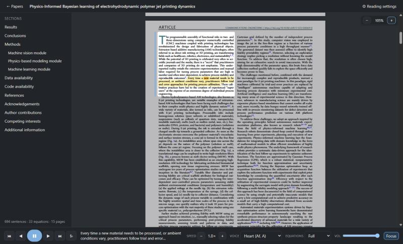
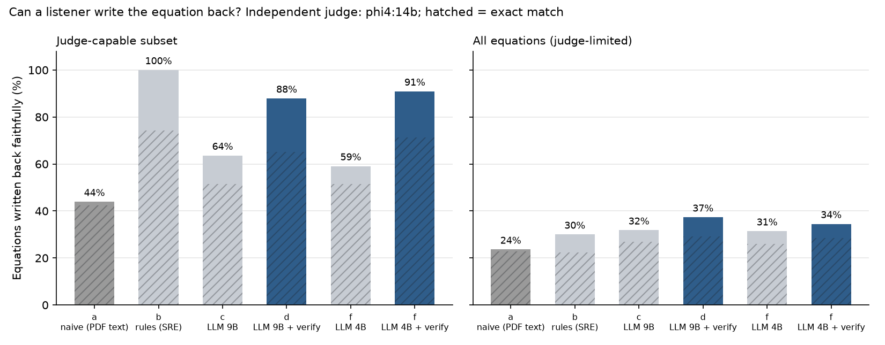
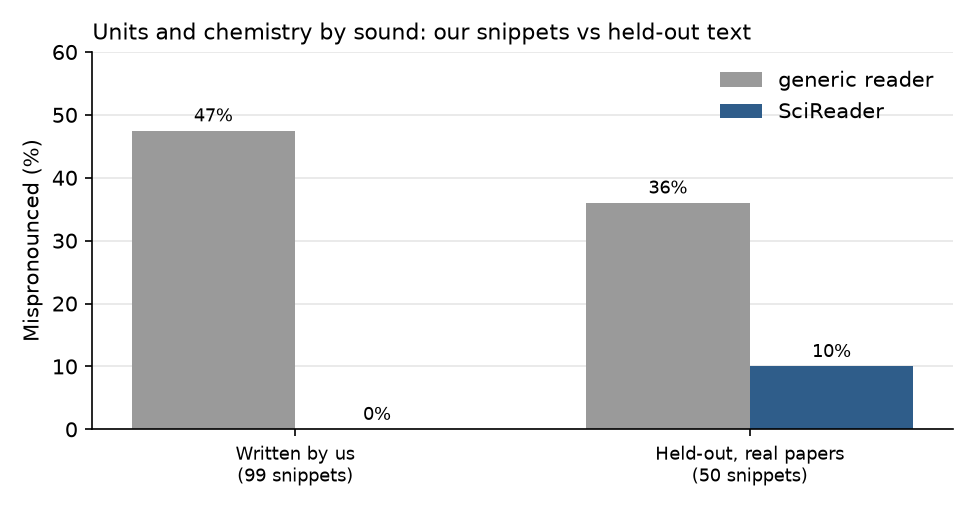
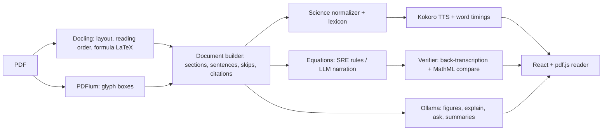

# SciReader

**An open-source, offline, science-aware read-aloud companion for scientific papers.**



The PDF stays in front of you exactly as published. In the background SciReader keeps a parsed copy of the paper (sections, sentences, equations as LaTeX, figures, captions, references, all with page coordinates). You click any sentence to start listening, and a highlight follows the voice on the real page. Equations, units and chemistry are spoken the way a scientist would say them. When an AI narrates an equation, an independent model writes the narration back as LaTeX and SciReader checks that it still is the same equation before speaking it.

Everything runs on your own computer, with Wi-Fi off: no accounts, no cloud APIs, no telemetry. That makes it usable on unpublished manuscripts and papers under review.

> Built in 36 hours, solo, for the OSI Hackathon 2026 ("Build the Future of Scientific Intelligence").

## Why

It's easy to lose your place in long text and reread the same lines. Audiobooks fixed that for books; nothing fixed it for papers. Read-aloud tools start at the first character and read everything: running headers, page numbers, "[12]", affiliations, the reference list. Equations come out as gibberish. Units are mangled: a good neural voice says "1.12 eV at 300 K" as "one point one two ee-vee at three hundred kay" and "MPa" as "em-pah". Commercial paper readers are closed, cloud-only subscriptions, and none says how faithfully it renders the math.

Researchers with dyslexia, ADHD or low vision, non-native readers, and anyone listening on a commute hit the same wall, and in physics, chemistry, materials science and math the wall is specifically **equations, units, chemical formulas and figures**.

## What it does

**Read like a scientist**
- Science-aware normalization (deterministic, 284 tests): units and compound units (`mW cm⁻²` → "milliwatts per square centimeter"), scientific notation, ±, ≈, ranges, Greek letters, sub/superscripts, chemical formulas and isotopes (`Fe₂O₃`, `Ca²⁺`, `¹³C`), abbreviations (Fig., Eq., et al., e.g.).
- Equations are announced and read from LaTeX with the Speech Rule Engine, or with **verified AI narration** (below). Full / Brief (labeled AI summary) / Skip modes; → skips the rest of a long equation.
- A shareable **pronunciation lexicon** (`lexicons/science-en.json`, 100+ polymer, additive-manufacturing and characterization terms: PEGDA → "peg-dah", Tg → "T G", PA12 → "P A twelve") plus your own lexicon, which overrides it.
- A **pronunciation review screen** lists the terms in the open paper that the voice will probably say badly, ranked by frequency. You hear each one in context, type how it should sound, preview, and save; the fix applies everywhere at once. Lexicons export and import (with keep-mine / take-theirs on conflicts), the seed of an open, community-grown science pronunciation dataset.

**Verified math narration** (the signature feature)
0. The source is checked first. The PDF parser's formula OCR gives each equation's LaTeX; the same local model, as a vision model, reads the equation again from the page. If the two readings agree, the source is confirmed. If not, the PDF's own text layer decides: its glyphs come out of order but are exactly what is printed, so the reading whose symbols match them better wins. If that can't decide, the parser's reading is kept and marked uncertain. On the flagship paper (Springer, noisy OCR) 13 of 32 equations are confirmed, 17 take the page reading (K⁻¹ that the OCR read as K¹, y read as γ, and all 3 equations the parser garbled), the text layer sides with the parser on 1, and 1 is uncertain.
1. A local LLM (`qwen3.5:9b`) narrates each display equation naturally.
2. A different model family (`gemma4:12b`), which never sees the LaTeX, writes the narration back as LaTeX.
3. Both are compared as canonical MathML trees (MathJax), not as strings.
4. On a mismatch the narrator gets one repair round ("'k_B T' came back as 'k_B' times 'T'"). If it still fails, SciReader falls back to the rule-based reading, and if even that is impossible it says only "Equation 3".
5. Only an exact round trip is spoken as AI narration. "Uncertain" (same symbols, different grouping) gets the rule-based reading too, because grouping is exactly where AI readings go silently wrong.

What you hear is a natural wording of the checked reading: no "sub" or "open parenthesis", "times" after a fraction, "the concentration of A" for [A] in kinetics, and in the default Auto mode a long equation is announced and summarized (labeled AI) instead of read for a minute. Precise mode speaks the explicit wording exactly as checked, which is also what SciSpeech-Bench scores.

Each equation gets a badge in the PDF's margin: *checking*, ✓ verified, ? uncertain, ✗ rules, unreadable (icons only when the margin is narrow; hovering a badge outlines its equation). Clicking it shows the equation (KaTeX), exactly what is spoken, which reading of the page it comes from and whether the two readings agreed, and the check's attempts. Playback never waits for the AI.

**Start anywhere, keep your place**
- Click any sentence or section heading to start reading there; sentence and word highlight on the PDF; auto-follow with "Back to reading position"; focus mode dims everything but the current paragraph.
- Skips page headers/footers, citation markers (including superscript numerals, detected from glyph size and baseline), affiliations, footnotes and the reference list (each a toggle). Hover a citation to see its reference.
- Resume where you left off; recent papers; a clean text view (Atkinson Hyperlegible or OpenDyslexic); optional pause after each paragraph; audiobook export (one MP3 per section).

**Figures and questions (all local AI, always labeled)**
- When the text first mentions a figure, the figure pops up where it was mentioned and SciReader reads its caption and a short AI description. It is panel-aware: "Fig. 3b" describes only panel b. `D` asks for more detail.
- `E` on a sentence that cites "Eq. (4)" shows the equation over the text, reads it, and resumes.
- Explain the current sentence (colleague level, or "Simpler"), ask the paper questions, or listen to a 1–2 minute summary. Answers come only from the paper and cite the sentences they use; citation chips jump to them on the PDF.

**Fully offline, one-click models**
- Kokoro-82M voices (28 English voices, ~0.06 s per sentence on an RTX 4070) and Ollama LLMs, managed from a model panel with downloads, deletion, a GPU-memory fit warning and a "Ready offline ✓" check.
- Scanned papers are detected and parsed with OCR. Papers on arXiv can use their own LaTeX source for exact equations.

## SciSpeech-Bench

An open benchmark of how faithfully read-aloud pipelines speak math, with an analysis notebook in [marimo](https://marimo.io) (`bench/analysis.py`, static export in `bench/analysis.html`).

- **Equations:** 220 display equations from 24 open arXiv papers (115 polymers/materials, 40 physics, 35 chemistry, 30 math), with the LaTeX from the arXiv source as ground truth. Each pipeline's speech is transcribed back to LaTeX by an independent judge model from a third family (`phi4:14b`) and compared structurally.
- **Units and chemistry by sound**, phonemized with the voice's own phonemizer. On **50 held-out snippets sampled automatically from 18 papers** (reference readings by a separate model, corrected blind to SciReader's output), **a generic reader mispronounces 36 %, SciReader 10 %**. On the 99 snippets we wrote ourselves it is 47 % vs 0 %, which says little, since we wrote them knowing the rules.



**What we found** (judge: `phi4:14b`, a third model family; details and caveats in [`bench/README.md`](bench/README.md)):
- **Unverified local LLM narration silently changes more than 1 in 3 equations.** On the 70 equations the judge can reliably transcribe (it reconstructs their rule-based reading), `qwen3.5:9b` narrations were written back faithfully only 61 % of the time; `qwen3.5:4b` 57 %.
- **Verification fixes most of it.** The gate catches 3 in 4 of those errors (recall 78 % for 9B, 77 % for 4B). Speaking AI narration only after an exact round trip raises faithful readings to **89 %** (9B) and **90 %** (4B); AI narration is used for 37 % of all equations (81 of 220), the rule-based reading for the rest. A small narrator plus the gate does as well as a bigger one.
- **Verified means verified:** in a manual check of 30 narrations (adjudicated by the agent that built the pipeline, so a sanity check rather than an independent audit), none of the 15 gate-verified ones was wrong, and every real error was rejected or marked uncertain. One of the two uncertain narrations was a real error (the Lorentz–Lorenz equation with Nα moved into the denominator), which is why uncertain narrations are not spoken.
- **A generic reader's text-layer reading** is faithful for only 43 % of those equations.
- **Naturalness (blind ratings by the author, 10 equations × 3 readings, 1–5):** naive 2.6, rules 3.8, AI narration as rated 4.0. Three of the ten rated AI narrations were uncertain, which SciReader no longer speaks; with the rules reading in their place, SciReader as shipped scores 3.8, the same as rules. So verified AI narration is about as easy to follow as the rule-based reading, and both are far above a generic reader (n = 10, one rater).
- Over all 220 equations the judge itself is the ceiling (it fails on many long equations even from a perfect reading), but the order holds: naive 25 % < rules 32 % < LLM 33 % < **LLM + verify 40 %**.
- **Prompt fixes didn't help.** Telling the narrator to say "capital Theta" and "evaluated at", and the checker that "end exponent" is not a symbol, fixed some equations on the flagship paper but made 9B narrations less faithful on the benchmark (61 → 53 % before the gate); changing only the checker let more errors through the gate. The shipped prompts are unchanged; the side-by-side numbers are in [`bench/README.md`](bench/README.md).



In the left panel, rules = 100 % by construction (that is how the subset is defined). The analysis is a [marimo](https://marimo.io) notebook: open `bench/analysis.html` without installing anything, or run `marimo edit bench/analysis.py` to filter by field and judge.

## How it works



- `backend/` (Python 3.12, FastAPI, uv): `parsing/` (Docling adapter, document builder, PDFium alignment, LaTeX cleanup, arXiv source mode), `speech/` (sentence splitter, English normalizer, lexicon, math speech client, pronunciation review), `tts/` (Kokoro engine, voice registry, audio cache), `llm/` (Ollama provider, verified narration, figures, explain/ask), `api/`, `store/`.
- `frontend/` (Vite, React, TypeScript, pdf.js, KaTeX, zustand). The UI follows the system theme; the PDF page is never darkened.
- `tools/math-speech/`: a small Node helper (MathJax + Speech Rule Engine) over JSON lines.
- `bench/`: SciSpeech-Bench data, scripts, results, figures and the marimo notebooks.

## Install and run (Windows)

Requirements: [uv](https://docs.astral.sh/uv/), Node.js LTS, git; an NVIDIA GPU helps but is optional. For the AI features, [Ollama](https://ollama.com) with `qwen3.5:9b` (reader) and `gemma4:12b` (checker); both can be downloaded from SciReader's model panel.

```powershell
git clone https://github.com/Shmiggly/SciReader
cd SciReader
./scripts/setup.ps1   # Python + Node dependencies, voice and parser models, UI build
./scripts/dev.ps1     # starts the backend and opens SciReader in its own app window
```

If PowerShell refuses to run scripts, use `powershell -ExecutionPolicy Bypass -File scripts\setup.ps1` (and the same for `dev.ps1`). Development with hot reload: `./scripts/dev.ps1 -Hot`. Sample papers: `uv run --no-project python scripts/fetch_samples.py`.

To start SciReader with a double-click, `./scripts/make-shortcut.ps1` puts a SciReader shortcut on the desktop. It opens the app window and keeps the backend in a minimized console; close that console to stop SciReader.

Configuration lives in `.env` (see `.env.example`): data folder, model folder, Ollama URL and model names.

## Pronunciation lexicons

Entries are plain respellings ("peg-dah", "T G") with an optional IPA field; see [`lexicons/README.md`](lexicons/README.md) for the format. Share your file from the pronunciation screen and contribute field packs back. Lexicon annotations are CC BY 4.0.

## Licenses

SciReader is Apache-2.0. Dependencies and models are tracked in [`docs/LICENSES.md`](docs/LICENSES.md); the one flag is misaki's GPL-3.0 espeak-ng fallback (fine for this open-source build). Model weights are downloaded by the user and never redistributed.
